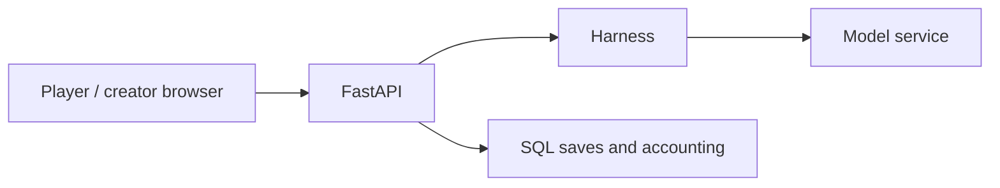
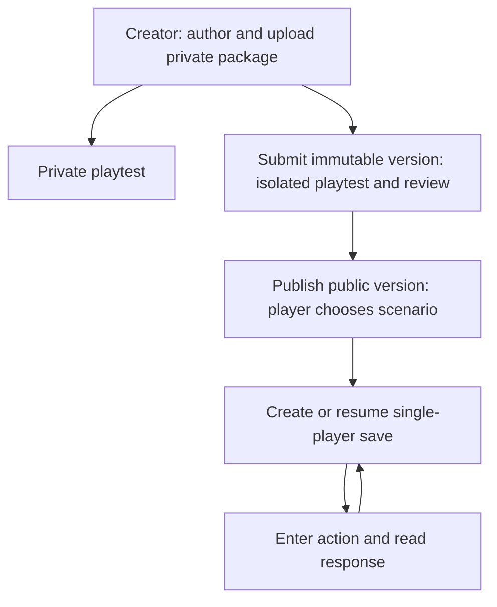
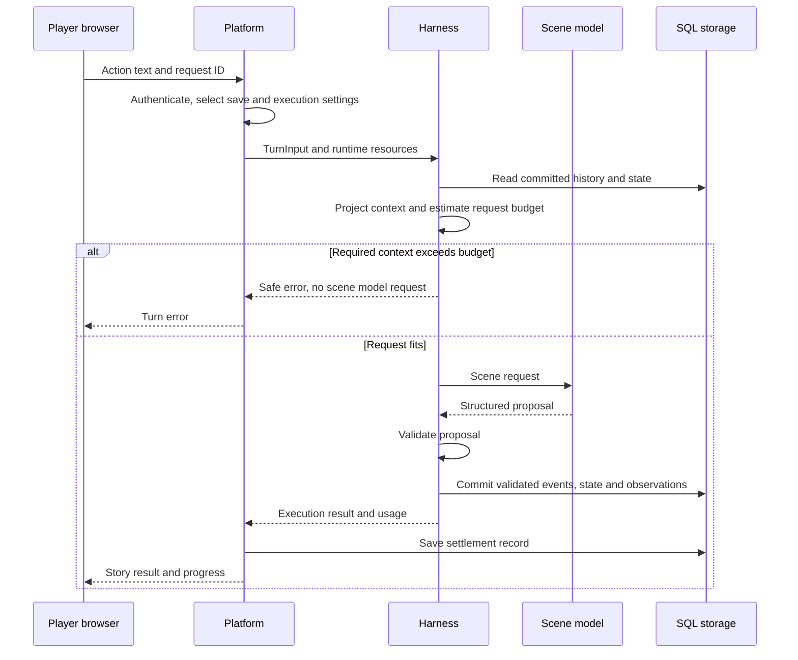

# StoryLoop Platform

[中文](README.md) · [English](README.en.md)

**Turn a scenario into an AI story you can play with your own words.** Players choose a story in the browser, create a solo save, and talk to characters or attempt actions. Creators write and upload scenarios, playtest them, and submit versions for review and publication.

- Type an action and read the story response and progress.
- Keep each game's history and state, then continue later.
- Make your own stories with characters, world state, and plot rules.

[Run it](#quick-start) · [Example](#example) · [Feedback and contributions](#feedback-and-contributions) · [Open an issue](https://github.com/storyloop0/storyloop-platform/issues)

## Example

The [harbor scenario](examples/freeform/manifest.json) starts in a square before the market opens: enter **“问码头工今天有什么消息”** (“Ask the dockhand what news there is today”), read the character's response, and choose your next action. Conversations and actions advance story time; the opening bell changes the harbor state.

This is an illustration based on the scenario source. Responses come from your selected model; it is not a captured live model run.

## Quick start

You need **Python 3.12+, Node.js 24, Git, and an API key for a compatible model service**. Play sends provider requests and incurs provider charges. The defaults use Alibaba Cloud's DashScope Hong Kong endpoint, which requires a key with access to that endpoint and model; check the [default provider and models](src/storyloop_platform/defaults/shared.json). For another service, see “Settings and model routing” below.

No key? Developers can try the [Harness offline example](https://github.com/storyloop0/storyloop-harness/blob/main/README.en.md#quick-start): it is a standalone Python narrative library, not a demo of this web app.

The commands below use Windows PowerShell. Use an empty `dist/harness` directory for the first build.

### 1. Clone and install the backend

```powershell
git clone https://github.com/storyloop0/storyloop-platform.git
cd storyloop-platform
py -3.12 -m venv .venv
Remove-Item Env:PYTHONPATH -ErrorAction SilentlyContinue
.\.venv\Scripts\python.exe scripts/build_harness.py --out-dir dist/harness
.\.venv\Scripts\python.exe -m pip install dist/harness/storyloop_harness-0.2.0-py3-none-any.whl -e ".[agents,portal]"
.\.venv\Scripts\python.exe scripts/check_environment.py --config config/local.json
```

The environment check makes no model requests and does not initialize a database.

### 2. Set your key and start the backend

```powershell
$env:STORY_MODEL_API_KEY = "your-api-key"
.\.venv\Scripts\python.exe -m storyloop_platform.cli.portal_api --catalog examples/catalog.json
```

### 3. Start the frontend in another terminal

In the new terminal, enter the cloned `storyloop-platform` directory, then run:

```powershell
cd web
npm ci
npm run dev
```

Open [http://127.0.0.1:5173](http://127.0.0.1:5173), register and sign in, select **港口 NPC 对话**, create a save, and enter the question above. Read the response on the play page when the turn finishes; continue from the save later. Local mode uses SQLite and disables player profiles. API docs are at [http://127.0.0.1:8765/docs](http://127.0.0.1:8765/docs).

If startup or the first turn fails, check the key, endpoint, and model access first, then the settings rules below. If it still fails, [open an issue](https://github.com/storyloop0/storyloop-platform/issues).

<details>
<summary>macOS / Linux</summary>

On macOS/Linux, create the environment with `python3.12 -m venv .venv` and replace Python paths with `.venv/bin/python`. Use `export STORY_MODEL_API_KEY="your-api-key"` for the key and `unset PYTHONPATH` to clear import overrides. Other CLI arguments and npm commands are the same.

</details>

## How it works



The platform owns the browser app, accounts, content, saves, and settlement; [Harness](https://github.com/storyloop0/storyloop-harness) owns context projection, narrative generation, and validation. The build script uses the Harness source revision pinned in [pyproject.toml](pyproject.toml).

Structured model attempts are also recorded in a best-effort SQL execution audit with pricing frozen when model work starts. Reported usage produces a known cost estimate; missing, incomplete, or unpriced attempts leave the total unknown. Estimates do not change player credit settlement or receipts. Running records after a hard exit remain unknown and never trigger model replay. Coverage currently excludes embedding, Mem0, and ordinary non-structured calls.

<details>
<summary>Content publication and ordinary turn flow</summary>



Private scenarios can be played by their owner; public catalog versions follow content review. Each save retains its own history and state, and the web interface offers interactive and novel presentation modes.

Ordinary turns use `single_call`: history, experiences, and worldbook entries visible to the player and relevant NPCs are projected into one shared scene request. The model proposes structured changes; Harness validates them and commits events, state, and observations through the platform store adapter. The platform then handles usage and credit settlement.



Long-session context selects recent and relevant experiences from committed history while retaining original events; the current worldbook retrieves JSON entries.

SQL storage supports Harness character checkpoint provenance and scenario validation. Upgrading clears old summary caches that have no verifiable sources while preserving events, observations, and world state. The platform does not yet configure an extra summarization model call; automatic compression needs explicit integration and quality and cost checks.

The diagram shows a successful ordinary scene and budget rejection, omitting validation failures, retries, and other story work. World commits and credit settlement are separate steps; there is no claim of atomic whole-campaign commits. NPC contexts represent identity, experience, and information perspectives, with no independent ReAct instance per NPC. The shared model sees multiple character contexts, so these projections do not provide hard information isolation. One ordinary scene generation does not mean openings, action suggestions, or an entire campaign make only one model call.

</details>

## Configuration and development reference

<details>
<summary>Settings and model routing</summary>

`default_settings("local")` and `default_settings("online")` load shared packaged model defaults plus a deployment profile. `load_settings(path)` applies an external JSON override; omitted `environment` means local. `config/local.json` and `config/online.json` are small storage, HTTP, and player memory overrides, rather than duplicated model catalogs. `examples/catalog.json` references scenario packages `freeform` and `scheduled` relative to the catalog directory.

Providers define endpoints and credential environment references. Model profiles reference a provider and own the model name, generation options, context window, timeout/retry policy, compatibility options, and tariff snapshot. Task routes (`single_turn`, `narration`, `prologue`, `followup_actions`) select chat profiles. Player memory independently selects extraction and embedding profiles. `credits` defines welcome points and points per RMB; each model's `rate` defines provider tariffs, cached input prices, multiplier, and pricing version. The included prices and capabilities are sample snapshots, not live verified tariffs or capability guarantees.

For a complete model override, save the following as `config/custom.local.json`. It uses the same sample provider/model as the defaults; replace the endpoint, model, capabilities, and rates with values appropriate for your service:

```json
{
  "environment": "local",
  "providers": {
    "default": {
      "base_url": "https://cn-hongkong.dashscope.aliyuncs.com/compatible-mode/v1",
      "api_key_env": "STORY_MODEL_API_KEY",
      "base_url_env": "STORY_MODEL_BASE_URL"
    }
  },
  "models": {
    "story": {
      "kind": "chat",
      "provider": "default",
      "model": "deepseek-v4.1-flash",
      "generation_max_requests": 3,
      "generation_timeout_seconds": 90,
      "generation": {"temperature": 0.7},
      "extra_body": {"enable_thinking": false},
      "tool_choice_policy": "auto_only",
      "structured_output_transport": "tool_call",
      "context_window_tokens": 1000000,
      "rate": {
        "pricing_version": "sample-2026-10-03",
        "input_rmb_per_million": "2",
        "output_rmb_per_million": "8",
        "cached_input_rmb_per_million": "0.2",
        "multiplier": "1"
      }
    }
  },
  "routes": {
    "single_turn": "story",
    "narration": "story",
    "prologue": "story",
    "followup_actions": "story"
  }
}
```

Validate and launch it with:

```powershell
.\.venv\Scripts\python.exe scripts/check_environment.py --config config/custom.local.json
.\.venv\Scripts\python.exe -m storyloop_platform.cli.portal_api --catalog examples/catalog.json --config config/custom.local.json
```

`providers`, `models`, and `routes` replace their entire maps; include every entry and route you need. Fixed sections (`runtime`, `http`, `player_memory`, `credits`) merge one level. Storage merges when its driver is unchanged and replaces when the driver changes. External relative SQLite paths resolve from the settings file's directory unless `storage.path_base` is `cwd`; packaged defaults use the working directory. Credentials belong in the referenced environment variables, never settings JSON.

New saves take their default temperature from `single_turn` (1.0 when unset). Save related scene, narration, and followup generation use the saved temperature override, including after a settings update; each profile's temperature applies when no save override is passed. Standalone prologue generation uses its own profile.

For structured generation, each chat profile defaults to at most 3 completion requests and a 90 second total deadline across retries and fallback. Set `generation_max_requests` and `generation_timeout_seconds` on that chat profile to change these positive limits. They apply per structured generation, not per whole turn; ordinary calls without a schema retain their existing behavior. The provider HTTP `timeout_seconds` and `max_retries` settings remain separate.

To check configured model access explicitly:

```powershell
.\.venv\Scripts\python.exe -m storyloop_platform.cli.model_check --profile local --config config/custom.local.json --task single_turn --task followup_actions
```

This command makes real provider requests and may incur charges. Omit `--task` to check all configured routes. `--help` is offline; the checker does not require database or player memory resources, including with `--profile online`.

</details>

<details>
<summary>Local launch selection and credential rules</summary>

The local CLI uses packaged defaults on the first launch. Missing keys can be entered at an interactive prompt; Windows protects remembered credentials with DPAPI. A nonempty provider key environment variable takes priority over remembered credentials, then the prompt. Noninteractive runs cannot prompt. `STORY_MODEL_BASE_URL` overrides the default provider endpoint when nonempty.

Local launch selection is `--catalog`, then `STORY_CATALOG`, then the remembered catalog. Without `--config`, successful local launches remember the custom settings path (or packaged defaults) and database path; `--db` overrides the remembered database. An explicit `--config` starts a fresh selection and requires `--catalog` or `STORY_CATALOG`; it does not inherit remembered settings or database paths. Online launches use `--profile online`, have no remembered local paths or key prompt, and validate required deployment environment values before creating resources. `--profile` must match the settings `environment`.

</details>

<details>
<summary>Service composition and shutdown lifecycle</summary>

`bootstrap.build_portal` composes production resources around one SQL Engine and owns their cleanup. `PlayerPortal` authenticates requests and delegates save lifecycle and queries to `GameplayService`, and execution and recovery to `TurnExecutionService`. Both services share content access, player operation locks, and a `GameplayRuntime`; tests inject offline runtime/model implementations through `runtime_factory_builder`.

HTTP and CLI share `portal.operations` to own long operations; disconnecting a request does not cancel an admitted turn. Upload and prologue commands are async, with file and memory threads tracked until their actual completion. `await portal.shutdown()` stops admission and requests memory worker stop, waits 30 seconds, then cancels and waits another 5 seconds. Work surviving both deadlines causes a visible failure with resources left open for the process manager to handle. Synchronous `portal.close()` requires completed operations. These deadlines exclude the server's own request drain and synchronous resource disposal.

</details>

<details>
<summary>Deployment example</summary>

The API Docker build uses uv 0.11.25, matching CI, to export the `agents,portal,online,observability,player-memory` runtime graph from `uv.lock`. It downloads hash checked dependencies and installs them and both project wheels with dependency resolution disabled. The final stage copies the installed environment; Git, source, the wheelhouse and test dependencies stay in the build stage. The runtime lock does not constrain the PEP 517 build environments' `setuptools>=77`; image tags and OS packages also remain unpinned, so builds are not claimed to be byte identical.

The Compose files in `deploy/ecs` build an installed API package and use the packaged online defaults. Copy `.env.example` to `.env`, keep it private, and copy `config/online.json` to the absolute host path in `STORY_SETTINGS_FILE` (for example `/srv/storyloop-settings/online.json`). Compose mounts that file read only at `/app/config/online.json`; the API selects it with `--profile online --config /app/config/online.json`. If `STORY_SETTINGS_FILE` is omitted, Compose mounts the repository's `config/online.json`.

Set the provider key/endpoint, URL-safe PostgreSQL password, persistent data/private scenario directories, public allowed hosts, and browser origins in `.env`, then run `docker compose --env-file deploy/ecs/.env -f deploy/ecs/compose.yaml up --build -d` from the repository root. The private catalog is `/app/private/catalog.json`; upload and memory paths are `/app/uploads` and `/app/memory`. Compose supplies `DATABASE_URL`, `STORY_UPLOAD_DIR`, and `STORY_MEMORY_DIR`. Collection of player preferences requires `STORY_PLAYER_MEMORY_ENABLED=1` and player consent; configured Mem0 still needs its profiles/credentials for existing preference read/delete access when collection is disabled.

The default story, memory extraction, and embedding profiles share the default provider. Custom profiles can use separate providers and environment references; add each referenced variable to the API service's Compose `environment` block and `.env`. Keep both memory profiles when replacing online model maps, or explicitly select `player_memory.driver: "none"` and clear `extraction_profile`/`embedding_profile` to `null`. Optional Langfuse settings and content tracing remain opt in.

</details>

<details>
<summary>Development commands and wire contracts</summary>

The Harness repository owns runtime, scene projection, event execution and AgentScope adapter tests. Platform tests own SQL, HTTP, content management, billing, lifecycle and protocol integration, using public Harness interfaces and `storyloop_harness.testing`. The full platform pytest suite runs one outside checkout wheel verification covering locked versions, runtime extras, noneditable installation, an offline HTTP/SQL turn and CLI entrypoints.

Install the test integrations and the uv version used by CI, then run the backend regressions with offline model fixtures. The wheel installation test invokes `uv`, builds the pinned harness revision, and creates a temporary environment, so a first run may still need network access to download dependencies.

```powershell
.\.venv\Scripts\python.exe -m pip install uv==0.11.25 dist/harness/storyloop_harness-0.2.0-py3-none-any.whl -e ".[agents,portal,observability,player-memory,online,test]"
$env:PATH = "$PWD\.venv\Scripts;$env:PATH"
$env:STORY_MODEL_API_KEY = "offline-test"
$env:LANGFUSE_PUBLIC_KEY = ""
$env:LANGFUSE_SECRET_KEY = ""
.\.venv\Scripts\python.exe -m pytest tests -q
cd web
npm ci
npm run contracts:check
npm test
npm run build
cd ..
.\.venv\Scripts\python.exe tests/player_contract_corpus.py
```

Player wire contracts are owned by `src/storyloop_platform/api/contracts.py`. From `web`, run `npm run contracts:generate` after changing them, then commit the generated JSON Schema, TypeScript types, and standalone validators under `web/src/lib/generated`. `contracts:check` regenerates from the Python source and fails on drift without writing files; set `CONTRACT_PYTHON` to select another Python executable. The explicit cross-language command above collects actual FastAPI responses using a temporary SQL store and offline models, then validates them with the production Node parsers. Ordinary backend pytest does not require Node.

For browser regressions, from `web` run `npx playwright install chromium` and `npm run test:e2e`; these use a mock API. CI checks the backend with Python 3.12 on Windows/Linux and the frontend and browser flows with Node.js 24 on Linux. The `offline-test` value is not a live model credential.

To check the local player path through the real web app, FastAPI, and SQLite, install the Python and Node dependencies above, then run `cd web; npm run test:integration`. It builds the frontend, starts local services on ports `5173` and `8765`, and uses a deterministic offline model to cover registration, save creation, an action, API process restart, login, and continuing the same save. Both ports must be free. The temporary database is removed afterward. Windows uses installed Edge; other systems use Playwright Chromium. Set `STORYLOOP_TEST_PYTHON` if Python is neither in the repository `.venv` nor on `PATH`. This check does not call a live provider or assess generated story quality or deployment.

```text
src/storyloop_platform/  API, SQL, configuration, model adapters, billing, CLI
web/                    React / Vite frontend
config/                 Small deployment settings overrides
examples/               Catalog and synthetic scenario packages
tests/                  Backend and independent installation regressions
deploy/ecs/             Docker Compose deployment resources
```

</details>

## Current limitations

The project is in incubation; APIs, settings, and storage formats may change. Use a single API worker: settlement snapshots support completed-turn recovery, but recovery across processes or multiple workers is not guaranteed. Character perspectives share one generation model and provide no hard information isolation. Request budgets are heuristic estimates for ordinary scene generation. Offline tests do not establish live narrative quality or production reliability.

<details>
<summary>Context budgets and developer inspection</summary>

Ordinary scene generation uses an estimated complete request budget: the effective window is the minimum of the saved preference, routed `single_turn` model window and runtime window. `single_turn` `generation.max_tokens` reserves output (4096 when omitted), with a 256-token safety margin. Configuration and save edits reject an output reserve that cannot fit. Persisted preferences above a reduced deployment ceiling are clamped on read without changing SQL rows. The supported AgentScope adapter sends the cap as `max_completion_tokens` and checks the expanded SDK request before HTTP. Other generators and whole-campaign spending are outside this budget.

Developers can inspect the actual factory-built engine with `engine.project_context(TurnInput(game_id, text, turn_id, package.version))`. This synchronous read-only method returns a detached request and a serializable `projection.report.to_dict()` with provenance IDs, selection/trimming reasons, component estimates, and estimator/policy identifiers. Use the existing explicit player preference scope when needed. Reports contain metadata rather than source text and remain developer-side; player HTTP/SSE responses receive a fixed safe error on required-material overflow. Estimates use a conservative heuristic rather than a provider tokenizer measurement. Mandatory overflow prevents that scene's model call and world writes; prior campaign work may already have committed.

</details>

## Feedback and contributions

Use [Issues](https://github.com/storyloop0/storyloop-platform/issues) for bugs or suggestions. Include your commit version, OS, minimal reproduction steps, and errors with keys and personal data removed. Contributions can start with the [example scenario](examples/freeform/manifest.json), a first-run fix, or a relevant regression test; submit a pull request.

## License

This project uses the [MIT License](LICENSE). StoryLoop Harness also uses MIT.
