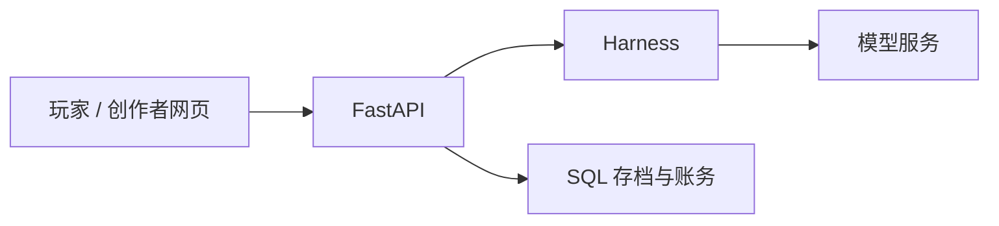
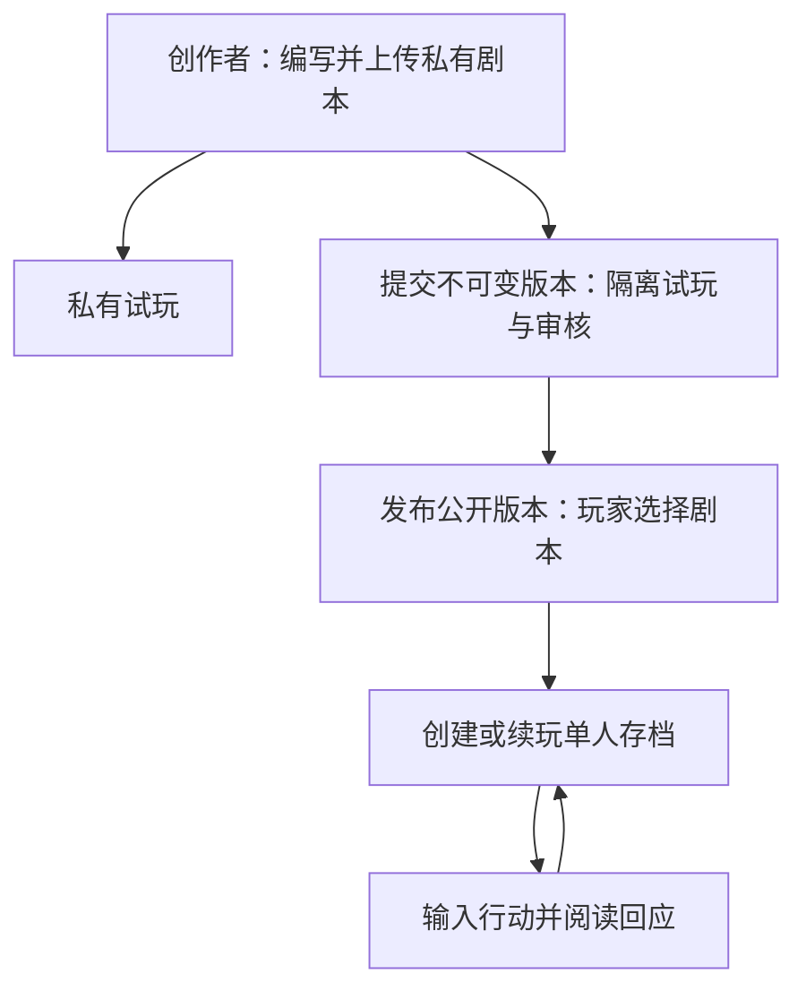
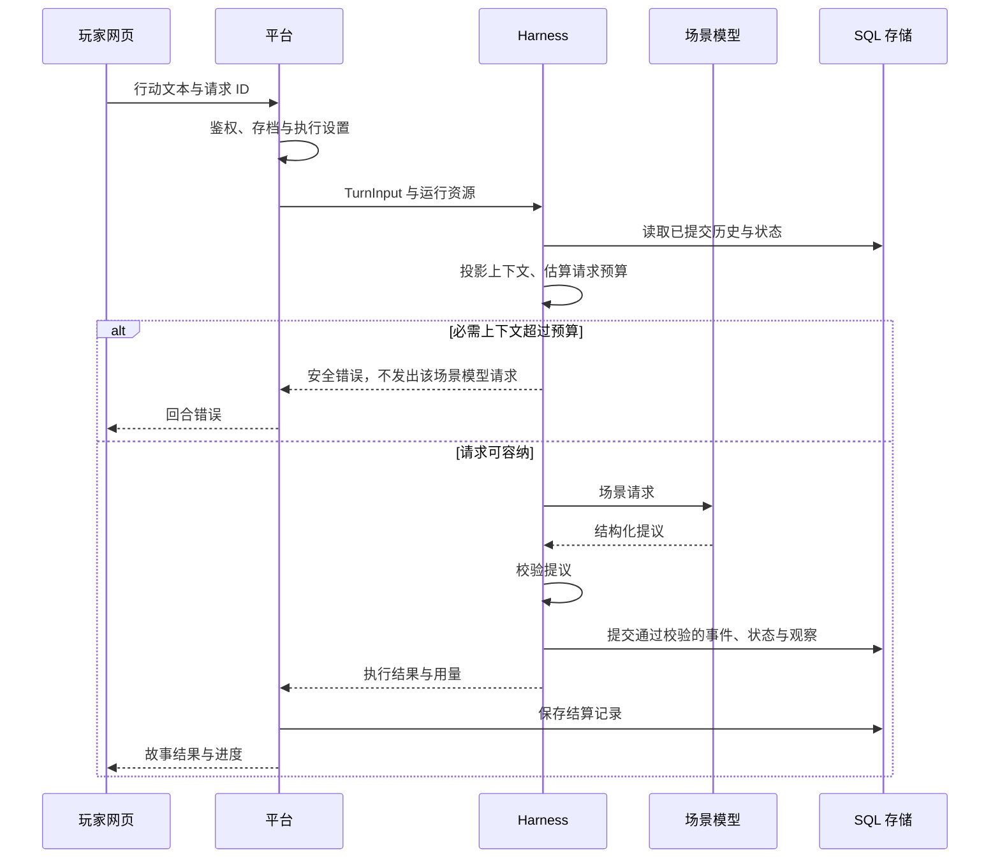

# StoryLoop Platform

[中文](README.md) · [English](README.en.md)

**把剧本变成可以自由输入、持续游玩的 AI 互动故事。** 玩家在网页里选择故事、创建单人存档，再用自己的话与角色交谈或尝试行动；创作者编写并上传剧本，试玩后提交版本供审核发布。

- 自由输入行动，阅读故事回应和进度。
- 保存每局的历史与状态，之后继续游玩。
- 用角色、世界状态和剧情规则制作自己的故事。

[开始运行](#快速开始) · [玩法示例](#玩法示例) · [反馈与贡献](#反馈与贡献) · [提 Issue](https://github.com/storyloop0/storyloop-platform/issues)

## 玩法示例

[港口 NPC 对话](examples/freeform/manifest.json)从尚未开市的广场开始：输入 **“问码头工今天有什么消息”**，阅读角色回应，再决定下一步行动。交谈和行动推进故事时间，开市钟响时港口状态会变化。

这是依据示例剧本编写的玩法示意，具体回应由所选模型生成，并非真实模型运行记录。

## 快速开始

需要 **Python 3.12+、Node.js 24、Git，以及兼容模型服务的 API 密钥**。游玩会向供应商发出请求，费用由供应商收取。默认配置使用阿里云 DashScope 香港端点，需要适用于该端点及模型的密钥；先核对[默认供应商和模型](src/storyloop_platform/defaults/shared.json)。换用其他服务见下方“配置与模型路由”。

没有密钥？开发者可以先运行 [Harness 的离线示例](https://github.com/storyloop0/storyloop-harness#快速开始)：它是独立 Python 叙事库，不是此网页应用的演示。

以下使用 Windows PowerShell。首次构建使用空的 `dist/harness` 目录。

### 1. 下载并安装后端

```powershell
git clone https://github.com/storyloop0/storyloop-platform.git
cd storyloop-platform
py -3.12 -m venv .venv
Remove-Item Env:PYTHONPATH -ErrorAction SilentlyContinue
.\.venv\Scripts\python.exe scripts/build_harness.py --out-dir dist/harness
.\.venv\Scripts\python.exe -m pip install dist/harness/storyloop_harness-0.2.0-py3-none-any.whl -e ".[agents,portal]"
.\.venv\Scripts\python.exe scripts/check_environment.py --config config/local.json
```

环境检查不调用模型，也不初始化数据库。

### 2. 设置密钥并启动后端

```powershell
$env:STORY_MODEL_API_KEY = "your-api-key"
.\.venv\Scripts\python.exe -m storyloop_platform.cli.portal_api --catalog examples/catalog.json
```

### 3. 另开终端启动前端

新终端先进入刚下载的 `storyloop-platform` 目录，然后执行：

```powershell
cd web
npm ci
npm run dev
```

打开 [http://127.0.0.1:5173](http://127.0.0.1:5173)，注册并登录，选择 **港口 NPC 对话**，创建存档，输入上面的问句。回合完成后，在游玩页阅读故事回应；后续可从存档继续。本地默认使用 SQLite，玩家画像关闭。API 文档在 [http://127.0.0.1:8765/docs](http://127.0.0.1:8765/docs)。

启动或首回合失败时，先核对密钥、端点和模型访问权限，再检查下方配置规则；仍有问题请[提交 Issue](https://github.com/storyloop0/storyloop-platform/issues)。

<details>
<summary>macOS / Linux</summary>

macOS/Linux 用 `python3.12 -m venv .venv` 创建环境，将 Python 路径替换为 `.venv/bin/python`；环境变量使用 `export STORY_MODEL_API_KEY="your-api-key"`，清除导入覆盖使用 `unset PYTHONPATH`。其余 CLI 参数和 npm 命令相同。

</details>

## 工作原理



平台负责网页、账号、内容、存档与结算；[Harness](https://github.com/storyloop0/storyloop-harness) 负责上下文投影、叙事生成与校验。构建脚本使用 [pyproject.toml](pyproject.toml) 中固定的 Harness 源码版本。

结构化模型尝试另存为尽力而为的 SQL 执行审计，模型工作开始时冻结费率。有效上报用量可估算已知费用；缺失、不完整或无费率的尝试使总费用保持未知。估算不改变玩家积分结算或回执。硬退出后仍为 running 的记录保持未知，不据此重放模型。当前覆盖不包括 embedding、Mem0 和普通非结构化调用。

<details>
<summary>内容发布与普通回合流程</summary>



私有剧本可以自行游玩；公开目录通过内容审核流程发布版本。每个存档保存自己的历史和状态，网页支持交互与小说两种展示方式。

普通回合采用 `single_call`：玩家与相关 NPC 的可见历史、经历和世界书条目被投影到同一个场景请求中。模型给出结构化提议，Harness 校验并通过平台存储适配器提交事件、状态与观察；平台随后处理用量和积分结算。



长局上下文从已提交历史中选择近期与相关经历，原始事件保留；当前世界书检索 JSON 条目。

SQL 存储已支持 Harness 的角色经历 checkpoint 来源与剧本校验；升级时会清除无法验证来源的旧摘要缓存，保留事件、观察和世界状态。平台目前未配置额外摘要模型调用，自动压缩仍需显式接入并验证质量与费用。

图中是成功普通场景及预算拒绝路径，省略校验失败、重试和其他剧情工作。世界提交与积分结算是分开的步骤，不承诺整场战役原子提交。NPC 上下文代表身份、经历和信息视角，每个 NPC 不对应独立 ReAct 实例；共享模型可看到多个角色的上下文，因此不构成角色之间的硬信息隔离。一次普通场景生成也不代表开场、行动建议或整场战役都只有一次模型调用。

</details>

## 配置与开发参考

<details>
<summary>配置与模型路由</summary>

`default_settings("local")` 和 `default_settings("online")` 加载包内共享模型配置及对应部署配置；`load_settings(path)` 应用外部 JSON 覆盖，省略 `environment` 表示本地。`config/local.json` 与 `config/online.json` 只包含存储、HTTP 和玩家记忆的少量部署差异，不复制模型目录。`examples/catalog.json` 的 `freeform` 和 `scheduled` 剧本包路径相对于该目录文件所在目录。

供应商定义端点和凭据环境变量引用；模型配置引用供应商，定义模型名称、生成参数、上下文窗口、超时重试、接口适配选项和价格快照；任务路由（`single_turn`、`narration`、`prologue`、`followup_actions`）选择聊天模型配置。玩家记忆分别选择提炼与向量模型配置。`credits` 定义赠送积分和每人民币对应积分，模型的 `rate` 定义供应商价格、缓存输入价格、倍率与价格版本。内置价格和能力是示例快照，未经实时验证，不构成当前价格或能力保证。

完整的模型覆盖示例如下，保存为 `config/custom.local.json`。它使用与默认配置相同的示例供应商和模型；换用其他服务时，应调整端点、模型、能力参数和价格：

```json
{
  "environment": "local",
  "providers": {
    "default": {
      "base_url": "https://cn-hongkong.dashscope.aliyuncs.com/compatible-mode/v1",
      "api_key_env": "STORY_MODEL_API_KEY",
      "base_url_env": "STORY_MODEL_BASE_URL"
    }
  },
  "models": {
    "story": {
      "kind": "chat",
      "provider": "default",
      "model": "deepseek-v4.1-flash",
      "generation_max_requests": 3,
      "generation_timeout_seconds": 90,
      "generation": {"temperature": 0.7},
      "extra_body": {"enable_thinking": false},
      "tool_choice_policy": "auto_only",
      "structured_output_transport": "tool_call",
      "context_window_tokens": 1000000,
      "rate": {
        "pricing_version": "sample-2026-10-03",
        "input_rmb_per_million": "2",
        "output_rmb_per_million": "8",
        "cached_input_rmb_per_million": "0.2",
        "multiplier": "1"
      }
    }
  },
  "routes": {
    "single_turn": "story",
    "narration": "story",
    "prologue": "story",
    "followup_actions": "story"
  }
}
```

验证并启动：

```powershell
.\.venv\Scripts\python.exe scripts/check_environment.py --config config/custom.local.json
.\.venv\Scripts\python.exe -m storyloop_platform.cli.portal_api --catalog examples/catalog.json --config config/custom.local.json
```

`providers`、`models`、`routes` 整张映射替换，需包含所需的全部条目和路由。固定配置段（`runtime`、`http`、`player_memory`、`credits`）合并一层；存储驱动相同时合并，改变驱动时替换。外部配置中的相对 SQLite 路径基于配置文件目录解析，除非显式指定 `storage.path_base: "cwd"`；包内默认路径基于当前工作目录。密钥只放在引用的环境变量中，不写入配置 JSON。

新存档从 `single_turn` 取得默认温度（未设置时为 1.0）。存档相关的场景、叙述、裁定和后续建议生成使用该存档保存的温度覆盖，包括更新设置后；没有传入存档覆盖时使用各模型配置自己的温度。独立开场生成使用自己的模型配置。

每个聊天模型配置的结构化生成默认最多发送 3 次补全请求，总期限为 90 秒，覆盖重试与回退。可在对应配置中设置正数 `generation_max_requests` 和 `generation_timeout_seconds`。单次结构化生成限制与整轮执行预算同时生效。供应商 HTTP 的 `timeout_seconds` 与 `max_retries` 是独立配置。

显式检查模型访问：

```powershell
.\.venv\Scripts\python.exe -m storyloop_platform.cli.model_check --profile local --config config/custom.local.json --task single_turn --task followup_actions
```

此命令会实际请求供应商，可能产生费用。省略 `--task` 会检查全部已配置路由；`--help` 可离线运行。模型检查无需数据库或玩家记忆资源，包括使用 `--profile online` 时。

</details>

<details>
<summary>本地启动参数与凭据选择规则</summary>

本地 CLI 首次启动使用包内默认配置。缺少密钥时可在交互终端输入，Windows 通过 DPAPI 保护记住的凭据。非空的供应商密钥环境变量优先，其次是记住的凭据，最后是交互输入；非交互运行不会询问。非空的 `STORY_MODEL_BASE_URL` 覆盖默认供应商端点。

本地剧本目录选择优先级为 `--catalog`、`STORY_CATALOG`、记住的目录。不传 `--config` 时，成功启动会记住自定义配置路径（或使用包内默认配置）和数据库路径；`--db` 覆盖记住的数据库。显式传入 `--config` 会重新选择，需要同时提供 `--catalog` 或 `STORY_CATALOG`，不会继承记住的配置或数据库路径。线上启动使用 `--profile online`，不读取本地记住的路径、不交互询问密钥，并在创建资源前验证必要的部署环境变量。`--profile` 必须与配置的 `environment` 一致。

</details>

### 整轮执行与偏好策略

`runtime.turn_max_requests` 默认 6，`runtime.turn_timeout_seconds` 默认 180 秒。场景、战役及其他兼容适配器调用共享该执行额度；预览和关闭计费的回合也受限。期限从预检查、剧本与偏好读取后开始，到视图构造完成结束，不包含排队/锁等待、SQL 审计收尾、积分结算、网络交付和后台记忆提炼。超限或超时返回固定 HTTP/SSE 错误，不自动重试；世界可能已经提交，成功用量扣费规则保持现有口径。

`player_memory.generated_preference_max_age_days` 默认 90；自动偏好按 UTC 创建时间满 90 天后退出提示词，画像仍可查看、纠正和删除。人工纠正持续有效；缺失、非法、无时区或未来日期的自动记录显示 unknown 并退出提示词。显式 `null` 关闭日期过滤。策略只读取现有最多 20 条候选，过滤后取最多 8 条，不额外调用 embedding，也不删除 Mem0 记录。

普通自由叙事的原生交互引擎会在调用前冻结计费模式、费率和可见观察边界，并在世界提交前保存成功场景。失败或重载后，网页可用保留的原请求 ID 和输入手动恢复：复用场景、完成持久待办，按原成功用量和原费率只结算一次；恢复不创建故事模型客户端，也不重新提炼旧输入。只读状态查询使用输入 SHA-256，明确可恢复后才开放按钮。

仅支持无蓝图的普通交互场景及最新请求。保存前中断仍可能重复生成；旧记录、损坏或变更的配置、未知计费用量和缺失原费率需要人工处理。战役、蓝图、预览、完整失败费用及多 worker 领取不在此恢复范围内。

<details>
<summary>服务装配与关闭生命周期</summary>

`bootstrap.build_portal` 围绕同一个 SQL Engine 组装生产资源并负责关闭。`PlayerPortal` 完成请求鉴权后，把存档生命周期与查询交给 `GameplayService`，把回合执行与恢复交给 `TurnExecutionService`。两个服务共享内容访问、玩家操作锁与 `GameplayRuntime`；测试通过 `runtime_factory_builder` 注入离线运行时或模型实现。

HTTP 与 CLI 使用同一个 `portal.operations` 管理耗时操作；请求断开不会取消已接收的回合。上传与序章生成采用异步命令，文件和记忆线程按实际完成状态跟踪。`await portal.shutdown()` 先停止接收新操作并通知记忆 worker，再等待 30 秒、取消后再等待 5 秒；仍未结束则显式报错并保留资源，由进程管理器决定终止。同步 `portal.close()` 只允许在操作已结束时调用。上述时限不包含服务器自身的请求排空和同步资源释放。

</details>

<details>
<summary>部署示例</summary>

API Docker 构建使用 CI 同版本的 uv 0.11.25，从 `uv.lock` 导出 `agents,portal,online,observability,player-memory` 运行依赖，下载并校验哈希，再禁用依赖解析安装第三方包与两个项目 wheel。最终阶段只复制安装后的环境；Git、源码、wheelhouse 和测试依赖留在构建阶段。运行依赖锁不约束 PEP 517 构建环境中的 `setuptools>=77`，镜像标签和系统包也未固定，因此不承诺逐字节可复现。

`deploy/ecs` 中的 Compose 文件构建并安装 API 包，使用包内线上默认配置。将 `.env.example` 复制为 `.env` 并妥善保密，将 `config/online.json` 复制到 `STORY_SETTINGS_FILE` 指定的主机绝对路径（例如 `/srv/storyloop-settings/online.json`）。Compose 将该文件只读挂载到 `/app/config/online.json`，API 使用 `--profile online --config /app/config/online.json` 选择它。未指定 `STORY_SETTINGS_FILE` 时，Compose 挂载仓库中的 `config/online.json`。

在 `.env` 设置供应商密钥和端点、URL 安全的 PostgreSQL 密码、持久化数据和私人剧本目录、公开允许主机和浏览器来源；然后从仓库根目录执行 `docker compose --env-file deploy/ecs/.env -f deploy/ecs/compose.yaml up --build -d`。私人目录为 `/app/private/catalog.json`，上传和记忆路径分别为 `/app/uploads`、`/app/memory`；Compose 提供 `DATABASE_URL`、`STORY_UPLOAD_DIR` 和 `STORY_MEMORY_DIR`。收集玩家偏好需设置 `STORY_PLAYER_MEMORY_ENABLED=1` 并获得玩家同意；即使关闭收集，已配置的 Mem0 仍需模型配置和凭据，以读取或删除已有偏好。

默认故事、记忆提炼和向量模型共享默认供应商。自定义配置可使用不同供应商和环境变量引用，需把每个引用变量加入 API 服务的 Compose `environment` 和 `.env`。替换线上模型映射时应保留两个记忆模型配置，或显式选择 `player_memory.driver: "none"` 并把 `extraction_profile`、`embedding_profile` 置为 `null`。Langfuse 和内容追踪仍按需开启。

</details>

<details>
<summary>开发命令与接口契约</summary>

Harness 仓库负责运行时、场景投影、事件执行和 AgentScope 适配器测试；平台测试负责 SQL、HTTP、内容管理、计费、生命周期与协议集成，只使用 Harness 公共接口及 `storyloop_harness.testing`。平台完整 pytest 包含一次仓库外 wheel 验证：检查锁定版本、运行时 extras、非 editable 安装、离线 HTTP/SQL 回合与 CLI。

安装全部测试相关集成及 CI 使用的 uv 版本，然后运行后端离线回归。wheel 安装测试会调用 `uv`、构建固定 harness 提交并创建临时环境，因此首次运行仍可能需要网络下载依赖。

```powershell
.\.venv\Scripts\python.exe -m pip install uv==0.11.25 dist/harness/storyloop_harness-0.2.0-py3-none-any.whl -e ".[agents,portal,observability,player-memory,online,test]"
$env:PATH = "$PWD\.venv\Scripts;$env:PATH"
$env:STORY_MODEL_API_KEY = "offline-test"
$env:LANGFUSE_PUBLIC_KEY = ""
$env:LANGFUSE_SECRET_KEY = ""
.\.venv\Scripts\python.exe -m pytest tests -q
cd web
npm ci
npm run contracts:check
npm test
npm run build
cd ..
.\.venv\Scripts\python.exe tests/player_contract_corpus.py
```

玩家接口契约由 `src/storyloop_platform/api/contracts.py` 定义。修改后在 `web` 运行 `npm run contracts:generate`，提交 `web/src/lib/generated` 中生成的 JSON Schema、TypeScript 类型与独立验证器。`contracts:check` 从 Python 源码重新生成并检查差异，不写入文件；可用 `CONTRACT_PYTHON` 指定 Python 可执行文件。上面的独立跨语言命令用临时 SQL 存储和离线模型收集真实 FastAPI 响应，再通过生产 Node 解析器验证；普通后端 pytest 无需 Node。

浏览器回归另在 `web` 运行 `npx playwright install chromium` 与 `npm run test:e2e`，使用模拟 API。CI 在 Windows/Linux 使用 Python 3.12 验证后端，并在 Linux 使用 Node.js 24 验证前端与浏览器。测试中的 `offline-test` 不是可用于真实游玩的密钥。

从真实网页到 FastAPI/SQLite 的本地玩家验收，在完成上述 Python 与 Node 依赖安装后运行 `cd web; npm run test:integration`。它构建前端，在本机 `5173`/`8765` 端口启动独立服务，以确定性离线模型完成注册、建档、行动、API 进程重启后登录与续玩；数据库使用测试临时目录并在结束后清理。端口需空闲，Windows 使用已安装的 Edge，其他系统使用 Playwright Chromium；如 Python 不在仓库 `.venv` 或 `PATH`，用 `STORYLOOP_TEST_PYTHON` 指定解释器。此验收不调用真实供应商，也不评价生成质量或线上部署。

```text
src/storyloop_platform/  API、SQL、配置、模型适配、计费和 CLI
web/                    React / Vite 前端
config/                 少量部署配置覆盖
examples/               剧本目录与合成剧本包
tests/                  后端与独立安装回归
deploy/ecs/             Docker Compose 部署资源
```

</details>

## 当前限制

项目仍在孵化，API、配置与存储格式可能直接变化。建议单个 API worker；符合上述资格的普通场景支持跨进程手动恢复，其他模式与多 worker 并发恢复尚未覆盖。角色视角共享一个生成模型，不提供硬信息隔离。请求预算是启发式估算，仅覆盖普通场景生成；离线测试不证明真实叙事质量或生产部署可靠性。

<details>
<summary>上下文预算与开发者检查</summary>

普通场景生成使用完整请求的估算预算：有效窗口取存档偏好、`single_turn` 路由模型窗口与运行时窗口的最小值。该模型的 `generation.max_tokens` 预留输出（未设置时为 4096），并保留 256 token 安全余量。配置与存档设置更新会拒绝无法容纳输出预留的窗口；部署上限降低后，存档偏好在读取时收紧，不改写 SQL 行。支持的 AgentScope 适配器以 `max_completion_tokens` 发送输出上限，并在 HTTP 前检查 SDK 展开后的请求。其他生成器和整场战役费用不属于此预算范围。

开发者可对实际工厂构建的引擎调用 `engine.project_context(TurnInput(game_id, text, turn_id, package.version))`。此同步只读方法返回独立请求及可序列化的 `projection.report.to_dict()`，包含来源 ID、选择与裁剪原因、分项估算和估算器/策略标识；需要玩家偏好时使用现有显式偏好作用域。报告仅包含元数据，不包含来源正文，仅用于开发者检查；必需材料溢出时，玩家 HTTP/SSE 接口只返回固定安全错误。token 数是保守启发式估算，不是供应商 tokenizer 测量。必需材料溢出会阻止该场景的模型调用及世界写入；更早的战役工作可能已经提交。

</details>

## 反馈与贡献

请在 [Issues](https://github.com/storyloop0/storyloop-platform/issues) 提交问题或建议，附上提交版本、操作系统、最小复现步骤与已去除密钥和个人数据的报错。可以从改进[示例剧本](examples/freeform/manifest.json)、修复首次运行问题或补充相应测试开始，提交 Pull Request。

## 许可证

本项目采用 [MIT License](LICENSE)。StoryLoop Harness 同样采用 MIT。
